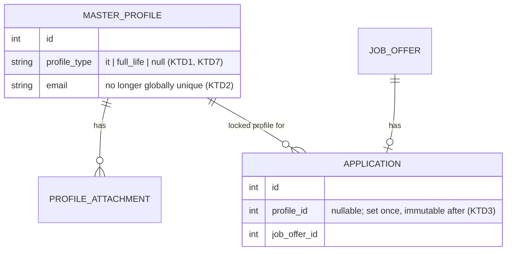
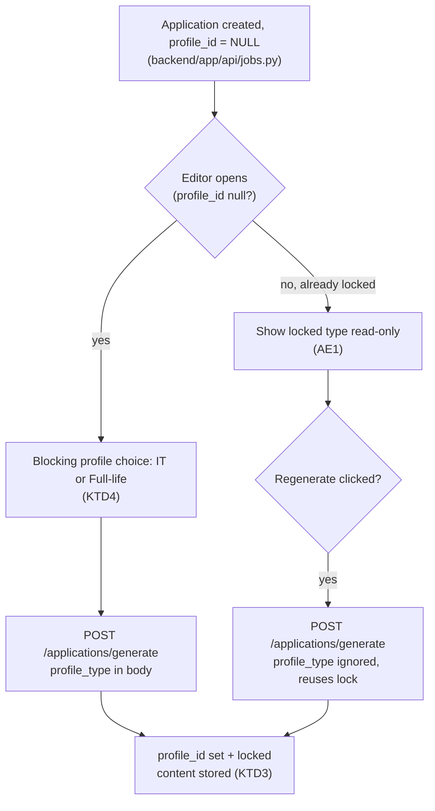

# Profile Types - Plan

## Goal Capsule

- **Objective:** Let the user maintain two independent profiles — IT and Full-life/Non-IT — and generate cover letters/CVs that match whichever profile is assigned to a given job application.
- **Product authority:** This plan.
- **Open blockers:** None.
- **Execution profile:** Deep. 9 implementation units across schema, backend, and frontend. U1 (schema) is the base dependency for every unit; U3 and U6 additionally depend on U2; U4 and U5 depend on U3; U7 depends on U2 and U6; U8 depends on U3; U9 depends on U3.
- **Tail ownership:** `ce-work` (or an equivalent executor) owns implementation, tests, and commit; this plan makes no code changes.

## Product Contract

**Product Contract preservation:** Product Contract unchanged — Requirements, Key Decisions, Key Flows, Acceptance Examples, and Scope Boundaries keep their original meaning and R/F/AE IDs. The Dependencies / Assumptions line is updated in place to record the resolution planning produced (see KTD3), which completes rather than changes the original assumption.

### Summary

The app supports two fully independent profiles, IT and Full-life/Non-IT, each with its own contact info, CV content, CV file, and attachments. A job application is manually assigned one profile, and cover letter/CV generation both pulls from that profile's own data and writes in a style suited to its type.

### Problem Frame

Today the app has exactly one profile record, and generation always pulls from it. An IT application benefits from a concise, technical CV and cover letter; other applications — especially ones that expect a full CV — benefit from a broader, more comprehensive profile. Producing both today means manually rewriting the single profile before every application, with no way to keep both versions side by side or to know which version was used for which application.

### Key Decisions

- **Profiles are fully independent, including contact info** (session-settled: user-directed — chosen over a shared/tagged data model, avoiding tagging and filtering complexity at the cost of duplicate entry when shared details change). Governs R1, R2, R3.
- **Profile assignment is manual per application and locked after first generation** (session-settled: user-directed — chosen over auto-detecting the profile from the job posting and over allowing a post-generation switch). Governs R4, R5.
- **Generation uses profile-type-aware writing style, not just different input data** (session-settled: user-directed — chosen over reusing one shared generation prompt for both profiles). Governs R6, R7.
- **Migration asks the user on first load which type the existing profile becomes** (session-settled: user-directed — chosen over auto-assigning it, avoiding a silent guess on data that's awkward to split apart later). Governs R8.
- **Supersedes the Sep-10 CV-builder plan's "one canonical CV, no variants" decision** — each profile now carries its own canonical CV (session-settled: user-directed, confirmed in this brainstorm's dialogue). See `docs/plans/2026-09-10-001-feat-cv-builder-editor-plan.md`. Governs R1, R2.

### Requirements

**Profile data & management**

- R1. The app supports exactly two profiles, "IT" and "Full-life/Non-IT", each a fully independent record — nothing is shared between them.
- R2. Each profile independently carries its own contact info (name, email, phone, address, LinkedIn, website, sender email), CV content (summary, job title, experience, education, skills, languages, projects), CV template choice, uploaded CV file, and additional attachments.
- R3. Editing one profile never changes the other profile's data.

**Assigning a profile to an application**

- R4. When generating for a job application, the user manually selects IT or Full-life/Non-IT; there is no automatic detection from the job posting.
- R5. Once an application has generated content, its assigned profile is locked. To use the other profile for the same job, the user creates a separate application.

**Generation content**

- R6. Generation uses the selected profile's own data exclusively — never mixes data from the other profile.
- R7. Generation writes in a style suited to the profile type: IT favors concise, technical, skills/tech-stack-forward writing; Full-life/Non-IT favors broader, narrative, comprehensive writing. This is a difference in generation instructions, not just a difference in input data.

**Migration**

- R8. On first load after this ships, the existing single profile is not auto-assigned a type. The user is prompted once to choose which type it becomes; the other profile starts empty.

### Key Flows

- F1. Generate for an application with a chosen profile
  - **Trigger:** User generates cover letter/CV content for an application that has none yet.
  - **Steps:** User picks IT or Full-life/Non-IT for this application -> generation runs using only that profile's data and its type-specific style -> content is stored and the profile assignment locks.
  - **Alternate:** The chosen profile is still sparse/empty in places -> generation proceeds with whatever fields are filled, same as today's single-profile behavior.
  - **Covers:** R4, R5, R6, R7.

- F2. First-run migration prompt
  - **Trigger:** User opens the app for the first time after this ships, with an existing single profile present.
  - **Steps:** App prompts once, asking whether the existing profile becomes "IT" or "Full-life/Non-IT" -> user chooses -> existing data is kept under that type; the other profile starts empty.
  - **Covers:** R8.

### Acceptance Examples

- AE1. Given an application with content already generated from the IT profile, when the user tries to switch that application to Full-life/Non-IT, then the app blocks the switch and the user creates a new application instead. Covers R5.
- AE2. Given two profiles with different summaries and skills, when content is generated for an application assigned to IT, then the output draws only from the IT profile's data. Covers R6.
- AE3. Given the same job offer, when content is generated once for an IT-assigned application and once for a Full-life/Non-IT-assigned application, then the two outputs differ in tone — concise/technical vs. broader/narrative — beyond just differing in facts. Covers R7.
- AE4. Given a fresh upgrade with one existing profile, when the user first opens the app, then a one-time prompt asks which type it becomes, and afterward the other profile exists but empty. Covers R8.

### Scope Boundaries

- Auto-detecting or suggesting a profile from the job posting — deferred.
- More than two profile types — out of scope; exactly IT and Full-life/Non-IT.
- Switching an application's profile after it has generated content — not supported; start a new application instead.
- This supersedes "one canonical CV, no variants" (`docs/plans/2026-09-10-001-feat-cv-builder-editor-plan.md`) only to the extent of one canonical CV per profile (two total), not arbitrary CV variants.

### Dependencies / Assumptions

- Each application needs a durable record of which profile generated its content, so the lock in R5 and the data-purity guarantee in R6 hold after the fact, not just in the current session. Modeled as a nullable `Application.profile_id` set on first generation (KTD3).

---

## Planning Contract

### Key Technical Decisions

- KTD1. **Model the two profiles as two `MasterProfile` rows distinguished by a `profile_type` column**, not a new table. Reuses the existing model, its attachments relationship, CV file, and template fields with zero column duplication. (session-settled: user-directed — chosen over a shared/tagged data model, per the governing Key Decision). Governs R1, R2, R3.
- KTD2. **Drop `MasterProfile.email`'s `unique=True` constraint.** A user plausibly applies from the same email for both job types; the current global-unique constraint would raise an `IntegrityError` on saving the second profile the moment it shares an email with the first, silently breaking R2. Rejected alternative: keep it unique per `profile_type` — no product benefit in a single-user app, and adds constraint complexity for nothing.
- KTD3. **`Application.profile_id` is a nullable FK to `master_profiles.id`, set on first successful generation and immutable afterward.** On a Regenerate call, the backend ignores or overrides any client-supplied profile field and reuses the stored value. Rejected alternative: require a profile at `Application` creation time — breaks the existing eager, profile-less `Application` row created at job-save time (`backend/app/api/jobs.py:76,109`); or re-ask the profile on every Regenerate — contradicts R5's lock. Governs R4, R5, R6.
- KTD4. **The profile choice for F1 is a blocking step in the application editor, shown exactly when `Application.profile_id` is null, before the existing auto-generate logic fires** — replacing the current unconditional auto-generate for that one case. Rejected alternative: a separate profile-picker screen earlier in the flow (job search or save) — adds a new route for one binary choice and moves the decision away from where generation actually happens.
- KTD5. **`backend/app/api/portal_fill.py` and `backend/app/api/cv_builder.py` are updated in this plan to resolve the profile via the application's locked `profile_id` (portal-fill) or an explicit `profile_type` parameter (CV builder), instead of `db.query(MasterProfile).first()`.** Required for R6's data-purity guarantee to hold on every surface that reads profile data, not only cover-letter generation — both are shipped features (browser-extension autofill, PR #44; CV builder, Sep-10 plan) that would otherwise silently read the wrong profile once a second one exists. Governs R6.
- KTD6. **Collapse the 10 near-duplicated `db.query(MasterProfile).first()` + 404 blocks in `backend/app/api/profile.py` into one `_get_profile_or_404(db, profile_type)` helper**, reusing the existing `_NO_PROFILE_DETAIL` constant with the type interpolated into the message.
- KTD7. **The first-run migration state is represented purely by `profile_type IS NULL` on the pre-existing row — no separate "migration done" flag.** An interrupted or abandoned choice simply leaves `profile_type` NULL, so the prompt reappears next load with nothing extra to track. Rejected alternative: a dedicated boolean/sentinel field — a second source of truth with no behavior beyond what NULL already represents. Governs R8.
- KTD8. **All new or changed profile-type-aware generation calls continue to route through the existing `generate_structured()`/`_call_chat()` helpers in `backend/app/services/llm_client.py`, not a new Ollama call path** — per institutional learnings on Ollama nested-list schema validation failures and concurrent-model memory pressure (see Sources). Governs R6, R7.
- KTD9. **The Alembic migration adding `profile_type` and `profile_id` follows the repo's existing guarded-column style (`sa.inspect(bind).get_columns(...)` before `add_column`) and is a single linear revision parented on the current head `d1a2b3c4e5f6`** — not a branch merge — per the institutional learning on Alembic sibling-branch merge pitfalls (see Sources).
- KTD10. **The same migration backfills `profile_id` on every pre-existing `Application` row that already has `cover_letter_text`, pointing it at the one profile row that existed before this migration ran.** At most one `MasterProfile` row exists before this ships, so every already-generated application was necessarily produced from it — the backfill target is not ambiguous, regardless of which type the user later assigns that row via R8. Without this, every pre-existing generated application is indistinguishable from a never-generated one, and Regenerate on it 422s instead of working (violates the Definition of Done's "Regenerate ... unmodified from the end user's perspective"). Governs R5, R6.
- KTD11. **`profile_type` is a plain (non-partial) `UNIQUE` column, not a conditional/partial index.** Under standard SQL semantics a `UNIQUE` constraint never treats two `NULL` values as equal, so untyped rows (pre-migration, or any future edge case) coexist freely on both SQLite and Postgres with no dialect-specific branching. Rejected alternative: a partial/conditional unique index scoped to non-null values — unneeded complexity this codebase has no existing precedent for, since the plain constraint already gives the exact "at most one row per type, unlimited untyped rows" behavior R1 needs. Governs R1.
- KTD12. **R5's "create a separate application" escape hatch is a new, explicit `for_new_application` flag on the generate request, not an implicit side effect of re-saving the job or of profile-scoping the existing upsert lookup.** `Application.job_offer_id` carries no DB uniqueness (unlike `JobOffer.source_url`, which is globally unique and 409s on re-save without creating a second `Application`), so the schema already permits a second row; what was missing was an explicit trigger. Rejected alternative: silently profile-scope the existing upsert lookup so a second row appears automatically whenever the other profile is requested — rejected because a retried or duplicated request could then silently multiply `Application` rows for the same job, and because `save_job`'s existing 409-on-resave guard (`backend/app/api/jobs.py`) gives users no path to reach that implicit behavior at all. Governs R5.

### High-Level Technical Design

### Sources / Research

- `backend/app/models/master_profile.py:20-116` — `MasterProfile` full schema, including the `email` unique constraint (line 27) and `attachments` relationship.
- `backend/app/models/profile_attachment.py:22-45` — FK pattern to mirror for `Application.profile_id`.
- `backend/app/models/application.py:26-73` — `Application` schema; the `status` Enum column (lines 41-46) is the pattern for `profile_type`.
- `backend/app/api/profile.py` — 10 call sites on `db.query(MasterProfile).first()` (lines 113, 126, 181, 210, 234, 257, 297, 326, 350, 384); `_NO_PROFILE_DETAIL` constant (lines 24-29); file-path helpers already keyed by `profile_id` (lines 40-58).
- `backend/app/api/applications.py:92,191,276` — the three call sites needing `application.profile_id`-aware resolution; existing 409 concurrent-generation guard (lines 53-54, 99-105) as precedent for application-layer invariant enforcement.
- `backend/app/api/portal_fill.py:141,152,307,315` — browser-extension autofill call sites (KTD5).
- `backend/app/api/cv_builder.py:89` — CV builder/preview call site (KTD5).
- `backend/app/services/ai_generator.py:27-158` — `_SYSTEM_PROMPT`, `_build_user_prompt`, `generate_application_content`.
- `backend/alembic/versions/d1a2b3c4e5f6_drop_automation_columns_add_report_id.py:39-87` — guarded-column migration style to follow (KTD9).
- `backend/app/api/jobs.py:76,109` — where `Application` rows are created profile-less, before any generation; `save_job`'s re-save path (`jobs.py` around line 76-92) 409s on a repeat `source_url` without creating a second `Application`, which is why U9 needs an explicit new trigger rather than an implicit side effect of re-saving (KTD12).
- `frontend/src/app/pages/profile/profile.component.html:14-230` — existing `mat-tab-group` pattern to reuse for the profile-type switcher.
- `frontend/src/app/pages/application-editor/application-editor.component.ts:120-166,366` — `loadOrGenerateApplication()` and `onRegenerate()`.
- `docs/solutions/database-issues/alembic-migration-rebase-silently-skips-sibling-branch.md` — Alembic merge pitfall (KTD9).
- `docs/solutions/integration-issues/ollama-structured-output-nested-list-schema-validation-failure.md` — nested-list schema handling (KTD8).
- `docs/solutions/performance-issues/ollama-concurrent-model-residency-memory-pressure.md` — shared call-path requirement (KTD8).
- `docs/solutions/ui-bugs/weasyprint-flexbox-does-not-fragment-across-pages.md` — CV template pagination constraint, relevant if any CV template markup is touched.
- `docs/plans/2026-09-19-001-feat-cover-letter-generation-quality-plan.md` — the already-shipped Regenerate feature this plan must stay compatible with (KTD3).
- `docs/plans/2026-09-10-001-feat-cv-builder-editor-plan.md` — the superseded canonical-CV decision.

---

## Implementation Units

### U1. Database schema: profile type and application profile link

- **Goal:** Add the schema foundation for two typed profiles and a durable per-application profile link.
- **Requirements:** R1, R2, R3, R5, R6, R8; KTD1, KTD2, KTD3, KTD7, KTD9, KTD10, KTD11.
- **Dependencies:** None.
- **Files:**
  - `backend/app/models/master_profile.py`
  - `backend/app/models/application.py`
  - `backend/alembic/versions/<new_revision>_add_profile_type_and_application_profile_id.py`
  - `backend/tests/services/test_master_profile_schema.py`
- **Approach:**
  1. Add `profile_type` to `MasterProfile` as `Enum("it", "full_life", native_enum=False, length=20, validate_strings=True)`, nullable (KTD7), matching `Application.status`'s column style.
  2. Drop `unique=True` on `MasterProfile.email` (KTD2).
  3. Add a plain `UNIQUE` constraint on `profile_type` — no partial index needed, since `NULL` is never unique against `NULL` under standard SQL semantics on either SQLite or Postgres (KTD11).
  4. Add nullable, indexed `profile_id` on `Application`, `ForeignKey("master_profiles.id", ondelete="SET NULL")` — `SET NULL` rather than `CASCADE` so deleting a profile does not delete application history.
  5. In the same revision's `upgrade()`, backfill `profile_id` on every existing `Application` row where `cover_letter_text IS NOT NULL`, pointing it at the id of the one `MasterProfile` row that exists before this migration (if any) (KTD10).
  6. Write one Alembic revision parented on head `d1a2b3c4e5f6`, using the guarded-column style from the cited pattern (KTD9).
- **Patterns to follow:** `backend/alembic/versions/d1a2b3c4e5f6_drop_automation_columns_add_report_id.py:39-87` (guarded columns); `backend/app/models/application.py:41-46` (Enum column); `backend/app/models/profile_attachment.py:28-30` (FK style).
- **Test scenarios:**
  - Happy path: `alembic upgrade head` on a DB at the previous head adds `profile_type` and `profile_id` without error.
  - Happy path: `alembic upgrade head` on a DB with one pre-existing `MasterProfile` row and 3 pre-existing `Application` rows (2 with `cover_letter_text` set, 1 without) backfills `profile_id` on exactly the 2 generated rows, pointing both at that profile's id (KTD10).
  - Edge case: `alembic upgrade head` on a DB with no pre-existing `MasterProfile` row leaves all `Application.profile_id` values `NULL` (nothing to backfill to).
  - Edge case: `alembic downgrade -1` cleanly reverses both column additions on a freshly-upgraded DB.
  - Edge case: running `alembic upgrade head` twice does not raise on the second run (guard works).
  - Integration: two `MasterProfile` rows with the same `email` but different `profile_type` both save successfully (proves KTD2).
  - Integration: two `MasterProfile` rows with the same `profile_type` — the second is rejected. A second row with `profile_type IS NULL` still saves successfully (proves KTD11).
- **Verification:** `cd backend && alembic upgrade head && alembic downgrade -1 && alembic upgrade head`; `pytest tests/services/test_master_profile_schema.py`.

### U2. Backend: profile-type-aware profile API

- **Goal:** Make every profile endpoint resolve the correct typed profile instead of always the first row.
- **Requirements:** R1, R2, R3; KTD1, KTD6.
- **Dependencies:** U1.
- **Files:**
  - `backend/app/api/profile.py`
  - `backend/tests/api/test_profile.py`
- **Approach:**
  1. Add a `profile_type` path or query parameter to every endpoint in `profile.py` (root GET/PUT/PATCH, CV file, photo, attachments).
  2. Add `_get_profile_or_404(db, profile_type)`, replacing the 10 duplicated `.first()` + 404 blocks, reusing `_NO_PROFILE_DETAIL` with the type interpolated (KTD6).
  3. `PUT`/upsert creates a new row for a `profile_type` with no row yet, instead of always updating "the" row.
  4. File-path helpers (`_cv_file_path_for`, `_attachment_file_path_for`, `_photo_path_for`, lines 40-58) already key off `profile_id` — no change needed once the correct row is resolved.
- **Patterns to follow:** existing `_NO_PROFILE_DETAIL` constant and 404 pattern (`profile.py:24-29`).
- **Test scenarios:**
  - Happy path: `PUT /profile/it` creates the IT row; `GET /profile/it` returns it; `GET /profile/full_life` still 404s.
  - Happy path: `PUT /profile/full_life` on an install with an existing untyped row does not collide with it.
  - Edge case: `GET /profile/it` before any IT row exists 404s with a message naming "IT".
  - Edge case: uploading a CV file to `it` and to `full_life` produces two distinct stored files, no overwrite.
  - Error path: `PUT /profile/bogus_type` returns 422.
  - Integration: an attachment uploaded under `full_life` is not returned when listing `it`'s attachments.
- **Verification:** `cd backend && pytest tests/api/test_profile.py`.

### U3. Backend: application profile assignment, lock, and generation

- **Goal:** Let a caller assign a profile on first generation, lock it, and have every application-scoped endpoint honor the assigned profile.
- **Requirements:** R4, R5, R6; KTD3.
- **Dependencies:** U1, U2.
- **Files:**
  - `backend/app/api/applications.py`
  - `backend/app/schemas/application.py`
  - `backend/app/models/application.py`
  - `backend/tests/api/test_applications.py`
- **Approach:**
  1. Add `profile_type: Literal["it","full_life"] | None` to `ApplicationGenerateRequest`.
  2. In `generate_application`: if `application.profile_id` is set, ignore/override any client-supplied `profile_type` and reuse the stored profile (KTD3). If unset, require `profile_type`, resolve via U2's helper, and set `application.profile_id` on successful generation.
  3. Update the PDF-download and send call sites (lines 191, 276) to resolve the profile via `application.profile_id` instead of `.first()`.
  4. Add a `profile: Mapped["MasterProfile"] = relationship(...)` on `Application` (mirroring the existing `job_offer`/`submission` relationships), and expose it in `ApplicationRead` as a nested `profile_type` field, matching the existing nested `job_offer`/`submission` pattern — this is what U8 reads to render the lock (AE1).
- **Patterns to follow:** existing 409 concurrent-generation guard (`applications.py:53-54, 99-105`) as precedent for application-layer invariant enforcement; the existing nested `job_offer`/`submission` fields on `ApplicationRead` as the pattern for exposing `profile_type`.
- **Test scenarios:**
  - Happy path: first generate with `profile_type: "it"` sets `profile_id` and generates from the IT profile.
  - Happy path (Regenerate): a second generate call for the same application, with no or a different `profile_type` in the body, still uses the already-locked profile. Covers AE1.
  - Error path: first generate with no `profile_type` and no prior lock returns 422.
  - Error path: first generate naming a profile type with no `MasterProfile` row yet returns 404.
  - Integration: PDF download and send-email for a generated application pull data from the locked profile only. Covers AE2.
- **Verification:** `cd backend && pytest tests/api/test_applications.py`.

### U4. Backend: profile-type-aware generation style

- **Goal:** Cover-letter generation writes in a style matching the assigned profile's type.
- **Requirements:** R6, R7.
- **Dependencies:** U3.
- **Files:**
  - `backend/app/services/ai_generator.py`
  - `backend/tests/services/test_ai_generator_profile_style.py`
- **Approach:**
  1. Add `profile_type` to `generate_application_content` and `_build_user_prompt`.
  2. Extend `_SYSTEM_PROMPT` with two short style blocks selected by `profile_type`: IT — concise, technical, tech-stack-forward; Full-life/Non-IT — broader, narrative, comprehensive (R7).
  3. `profile_payload` continues to build from the resolved profile's own fields only — R6 is satisfied structurally once U3 always resolves the correct row before calling this function.
  4. Keep routing through `generate_structured()`/`_call_chat()` (KTD8) — no new call path.
- **Test scenarios:**
  - Happy path: calling with `profile_type="it"` vs `"full_life"` against comparable profile content produces system prompts with different style blocks — a prompt-construction unit test, not an LLM-output test.
  - Integration: `generate_application_content` called with the IT profile's data never includes a Full-life-only field — exercised by U3's integration test; cited here as the owning generation-layer contract.
  - Test expectation: the actual LLM output tone (AE3) is not asserted by automated tests, consistent with the existing limitation noted in the Sep-19 cover-letter-quality plan; verify manually per that plan's precedent.
- **Verification:** `cd backend && pytest tests/services/test_ai_generator_profile_style.py`.

### U5. Backend: extend profile-purity to portal-fill autofill and CV builder

- **Goal:** Autofill and the CV builder resolve the same locked/typed profile as generation, not an arbitrary row.
- **Requirements:** R6, R1, R2; KTD5.
- **Dependencies:** U1, U3.
- **Files:**
  - `backend/app/api/portal_fill.py`
  - `backend/app/api/cv_builder.py`
  - `backend/tests/api/` (extend or add coverage for both routers)
- **Approach:**
  1. In `get_portal_fill_context`/`answer_portal_fill_question` (lines 152, 315), switch `db.query(MasterProfile).first()` to `db.get(MasterProfile, application.profile_id)` — both already resolve an `Application` first; 404 with a clear message if the application has no locked profile yet.
  2. Add a required `profile_type` query parameter to the `preview_cv` and `export_cv` routes that call `cv_builder.py:89` (not to the `CvRenderRequest` body schema, which represents editable CV content, not profile identity), threaded through to resolve via U2's `_get_profile_or_404` helper — the CV builder has no "current application" context to lock onto.
- **Patterns to follow:** U2's `_get_profile_or_404(db, profile_type)` helper (reuse, don't reimplement).
- **Test scenarios:**
  - Happy path: portal-fill context for an application locked to Full-life returns that profile's data, not IT's.
  - Edge case: portal-fill context for an application with no locked profile yet returns a clear error, not a silently-wrong profile.
  - Happy path: `GET /cv-builder?profile_type=it` and `?profile_type=full_life` return each profile's own canonical CV content, independently editable. Covers R1, R2.
- **Verification:** `cd backend && pytest tests/api/`.

### U6. Backend: first-run migration endpoint

- **Goal:** Let the existing untyped profile row become one of the two types, once, via explicit user choice.
- **Requirements:** R8; KTD7.
- **Dependencies:** U1, U2.
- **Files:**
  - `backend/app/api/profile.py`
  - `backend/tests/api/test_profile.py`
- **Approach:**
  1. Add `GET /profile/migration-status`, returning whether an untyped row (`profile_type IS NULL`) exists.
  2. Add `POST /profile/migrate` accepting `{ profile_type: "it" | "full_life" }`, setting the existing untyped row's type (KTD7 — no separate flag).
  3. Reject with 409 if no untyped row exists (already migrated, or nothing to migrate on a fresh install).
- **Test scenarios:**
  - Happy path: on a pre-migration DB, `POST /profile/migrate {"profile_type":"it"}` sets the row's type; `GET /profile/migration-status` then reports nothing left to migrate.
  - Edge case: calling `POST /profile/migrate` a second time returns 409.
  - Edge case: on a fresh install with zero profile rows, `GET /profile/migration-status` reports nothing to migrate.
- **Verification:** `cd backend && pytest tests/api/test_profile.py`.

### U7. Frontend: profile management UI for two typed profiles

- **Goal:** Let the user view and edit both profiles, and complete the first-run migration choice.
- **Requirements:** R1, R2, R3; KTD1.
- **Dependencies:** U2, U6.
- **Files:**
  - `frontend/src/app/pages/profile/profile.component.ts`
  - `frontend/src/app/pages/profile/profile.component.html`
  - `frontend/src/app/core/services/profile.service.ts`
  - CV builder route/component (verify exact path before editing)
- **Approach:**
  1. Add a top-level profile-type switcher (two tabs, reusing the existing `mat-tab-group` pattern) above the existing per-field tabs, carrying `profile_type` in the route/state.
  2. `ProfileService` methods take a `profileType` parameter and call the U2/U6 endpoints.
  3. On load, call `GET /profile/migration-status`; if an untyped row exists, show a one-time blocking choice before rendering either profile tab, then call `POST /profile/migrate`.
  4. Apply the same profile-type switcher to the CV builder page.
  5. If the current tab has unsaved form edits, switching the top-level profile-type tab prompts a confirm/discard dialog before switching; declining keeps the current tab and edits intact.
  6. Both blocking dialogs (migration choice, unsaved-edits confirm) trap focus while open, return focus to a sensible element on close, use `role="dialog"`/`aria-modal`, and are fully keyboard-operable.
- **Patterns to follow:** existing `mat-tab-group` structure (`profile.component.html:14-230`); Angular Material's dialog component for the confirm/discard and migration prompts (already provides focus trap and ARIA roles out of the box).
- **Test scenarios:**
  - Happy path: switching the top-level tab from IT to Full-life with no unsaved edits loads that profile's own data, with no cross-contamination.
  - Happy path: on first load with an untyped row, the migration dialog appears before any profile form renders; choosing "IT" hides the dialog and shows the IT tab populated with the migrated data.
  - Edge case: on first load with no untyped row, the migration dialog does not appear.
  - Edge case: switching tabs with unsaved edits on the current tab prompts a confirm/discard dialog; declining keeps the edits and the current tab.
- **Verification:** `cd frontend && npm run test:vitest`.

### U8. Frontend: application editor profile picker and lock

- **Goal:** Let the user pick a profile before first generation, and reflect the lock afterward.
- **Requirements:** R4, R5; KTD3, KTD4.
- **Dependencies:** U3.
- **Files:**
  - `frontend/src/app/pages/application-editor/application-editor.component.ts`
  - `frontend/src/app/pages/application-editor/application-editor.component.html`
  - `frontend/src/app/core/services/application.service.ts`
- **Approach:**
  1. In `loadOrGenerateApplication()`, when `application.profile_id` is null, show a blocking profile choice (two selectable cards, IT / Full-life, plus a "Continue" button — selecting a card does not itself submit) before calling `generateForFirstTime` — replacing the unconditional auto-generate for that case only (KTD4). The dialog traps focus, uses `role="dialog"`/`aria-modal`, and is fully keyboard-operable.
  2. Pass the chosen `profile_type` in the generate request body when "Continue" is confirmed.
  3. If generation 404s because the chosen profile type has no `MasterProfile` row yet, show a message naming the profile ("The IT profile has no data yet") with a link to that profile's page, instead of a generic generation-failure error.
  4. Once `profile_id` is set, display the assigned type read-only (AE1); leave `onRegenerate()` unmodified — it already calls generate with no profile field, and U3's backend logic reuses the lock (KTD3).
- **Patterns to follow:** existing generation-in-progress disable pattern covering Regenerate/Save/Send (Sep-19 cover-letter-quality plan, R8).
- **Test scenarios:**
  - Happy path: opening the editor for a fresh application (no `profile_id`) shows the profile choice before any generation call fires.
  - Happy path: choosing "Full-life" and confirming triggers generation with `profile_type: "full_life"` in the body.
  - Edge case: opening the editor for an application that already has `profile_id` set skips the choice and shows the locked type read-only. Covers AE1.
  - Edge case: choosing a profile type with no `MasterProfile` row yet shows the named-profile error message with a link, not a generic failure.
  - Integration: clicking Regenerate on a locked application sends the existing unmodified request; the displayed locked profile type does not change.
- **Verification:** `cd frontend && npm run test:vitest`.

### U9. Backend + Frontend: create a separate application for the other profile

- **Goal:** Let the user act on R5/AE1's escape hatch — start a genuinely new application for the same job with the other profile, once the current one is locked.
- **Requirements:** R5; KTD12.
- **Dependencies:** U3.
- **Files:**
  - `backend/app/api/applications.py`
  - `backend/app/schemas/application.py`
  - `backend/tests/api/test_applications.py`
  - `frontend/src/app/pages/application-editor/application-editor.component.ts`
  - `frontend/src/app/pages/application-editor/application-editor.component.html`
  - `frontend/src/app/core/services/application.service.ts`
  - `frontend/src/app/app.routes.ts`
- **Approach:**
  1. Add `for_new_application: bool = False` to `ApplicationGenerateRequest`. When `true` and the named `job_offer_id` already has at least one `Application`, `generate_application` creates a brand-new `Application(job_offer_id=...)` row instead of reusing the existing one, and locks it to the requested `profile_type` (KTD12).
  2. Change `GET /applications/by-job-offer/{job_offer_id}` from returning a single `ApplicationRead` to `list[ApplicationRead]`, since a job can now have more than one application.
  3. Change the application editor route from `/editor/:jobOfferId` to `/editor/:jobOfferId/:applicationId` (falling back to the single application when only one exists, for existing links/bookmarks) so a specific application among several for the same job is addressable.
  4. On a locked application's editor (AE1's blocked-switch state), add a "Start a new application with the other profile" action that calls generate with `for_new_application: true` and the other `profile_type`, then navigates to the new application's editor.
  5. Update the applications list view to show one row per application (not per job) when a job has more than one, distinguished by profile type.
- **Patterns to follow:** the existing `list_applications`/`ApplicationRead` list-response shape (`applications.py` root `GET`) as the template for the now-list-returning by-job-offer endpoint.
- **Test scenarios:**
  - Happy path: on a job with an application already locked to IT, calling generate with `for_new_application: true, profile_type: "full_life"` creates a second `Application` row locked to Full-life, leaving the first untouched.
  - Happy path: `GET /applications/by-job-offer/{id}` on a job with two applications returns both.
  - Edge case: `for_new_application: true` on a job with zero existing applications behaves like a normal first generation (no spurious second row).
  - Edge case: navigating to `/editor/:jobOfferId` (no `:applicationId`) on a job with exactly one application still resolves it.
  - Integration: the "Start a new application with the other profile" action is only shown when the current application is locked to a profile different from the one being offered. Covers R5, AE1.
- **Verification:** `cd backend && pytest tests/api/test_applications.py`; `cd frontend && npm run test:vitest`.

---

## Verification Contract

| Command | Applies to | Notes |
|---|---|---|
| `cd backend && alembic upgrade head && alembic downgrade -1 && alembic upgrade head` | U1 | Confirms the migration applies, backfills, and reverses cleanly. |
| `cd backend && pytest` | U1-U6, U9 | Full backend suite; run the scoped test file per unit during development. |
| `cd frontend && npm run test:vitest` | U7, U8, U9 | Frontend suite. |
| `grep -rn "db.query(MasterProfile).first()" backend/app/api/` | U2, U3, U5, U6 | Must return no matches once all units land — the completeness signal for R6. |

## Definition of Done

- All 9 units implemented; every listed test scenario has a passing test.
- `cd backend && pytest` and `cd frontend && npm run test:vitest` both green.
- No remaining `db.query(MasterProfile).first()` call site in `backend/app/api/`.
- Every pre-existing `Application` row with a stored cover letter has a non-null `profile_id` after the migration (KTD10) — spot-check on a copy of the current database before shipping.
- Regenerate (Sep-19 plan) and browser-extension autofill (PR #44) both still work end-to-end against a locked profile, unmodified from the end user's perspective, including for applications that existed before this shipped.
- Abandoned-attempt code from any approach that didn't pan out is removed before declaring done.

---

## System-Wide Impact

Touches 4 backend routers (`profile`, `applications`, `portal_fill`, `cv_builder`), the database schema (one Alembic migration with a data backfill), the AI generation prompt, and 2 frontend page areas (profile/CV builder, application editor), plus a route change (`/editor/:jobOfferId` gains an `:applicationId` segment, U9). It also changes the behavior of two already-shipped features — Regenerate (Sep-19 cover-letter-quality plan) and browser-extension autofill (PR #44) — both of which must keep working unmodified from the end user's perspective, including for pre-existing data (KTD3, KTD10, U5). No auth/security boundary changes; the app remains single-user.

---

## Risks & Dependencies

- **Email uniqueness** — the current global `unique=True` on `MasterProfile.email` would block a shared email across the two profiles; mitigated by KTD2.
- **Regenerate compatibility, including pre-existing applications** — the already-shipped Regenerate button calls generate with no profile field, and every application generated before this ships would otherwise have no locked profile; mitigated by KTD3 (lock reuse) plus KTD10 (migration backfill for pre-existing rows).
- **Silent profile-purity gaps** — without U5, `portal_fill.py` and `cv_builder.py` would keep reading an arbitrary profile row once a second one exists, violating R6 on two shipped surfaces; this plan does not defer U5.
- **Migration idempotency** — an interrupted first-run choice must not strand the app in an ambiguous state; mitigated by KTD7 (NULL is the only "not yet chosen" state, no separate flag to get out of sync).
- **Breaking `/profile` route change deployed out of order** — U2 restructures the untyped `/profile` endpoints into type-scoped routes (e.g. `PUT /profile/it`); if backend and frontend are rebuilt/redeployed independently, a still-running old frontend would fail against the new route shape. Given this is a single-user, self-hosted app (`docker-compose`), the mitigation is procedural, not architectural: rebuild and redeploy backend and frontend together (`docker-compose up --build`) for this change, rather than adding a versioned transition route.
