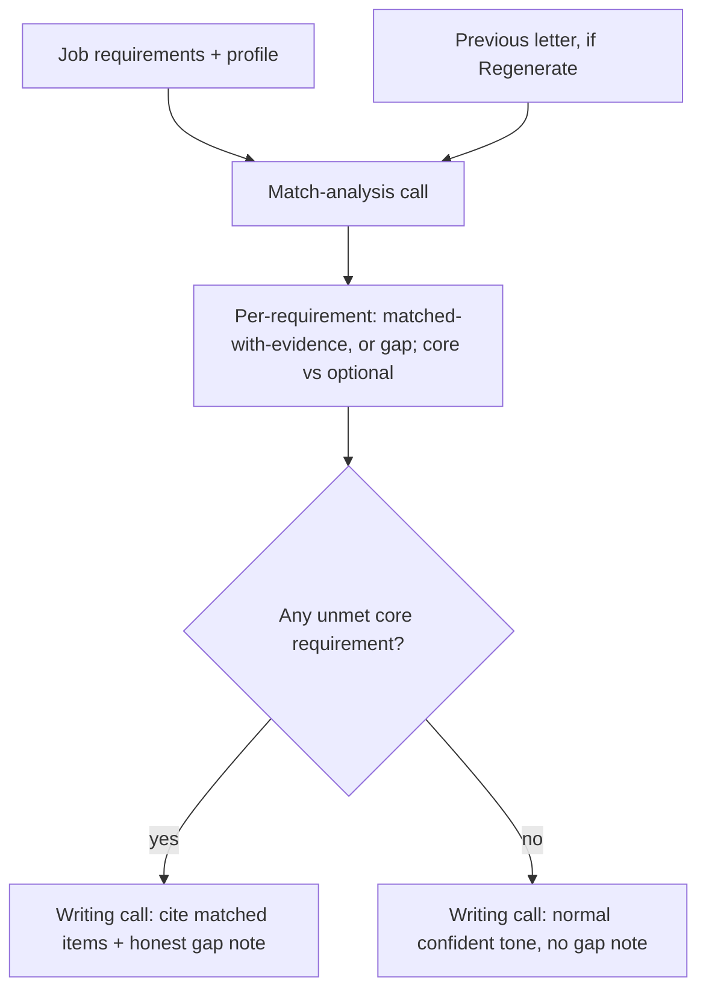
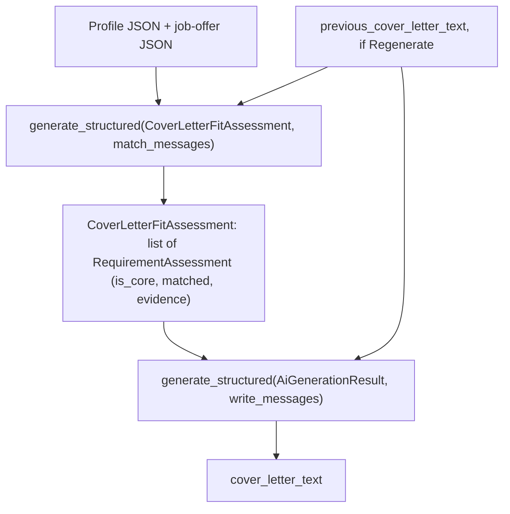

# Cover Letter Fit Grounding - Plan

## Goal Capsule

- **Objective:** Stop AI-generated cover letters from fabricating skills or experience the applicant doesn't have, by grounding the letter-writing step in an explicit per-requirement match/gap assessment against the actual profile, so a genuine gap is named honestly — citing the applicant's real matching skills/education and framing the gap as learnable with high interest — instead of being papered over with invented fit.
- **Product authority:** This plan.
- **Open blockers:** None.

## Product Contract

**Product Contract preservation:** Product Contract unchanged.

### Summary

Cover-letter generation gains an explicit, structured match step that runs before the letter is written, so the writing step is grounded in a computed assessment rather than a single model's free judgment. Genuine gaps against a job's core requirements are named honestly, citing the applicant's actual matching skills/education and framing the gap as learnable with high interest; claims of unearned experience are prevented at the mechanism level, not just discouraged by instruction.

### Problem Frame

The existing honest-fit rule (`_SYSTEM_PROMPT`'s "Ehrliche Passung" section, `backend/app/services/ai_generator.py:59-71`) asks the model to judge, in the same pass that writes the letter, whether the job shows a clear gap against the applicant's profile, and if so to name it honestly instead of overstating fit. In practice the local model (`qwen2.5:7b-instruct`, configured via `OLLAMA_MODEL` in `backend/app/core/config.py:74`) does not reliably apply this.

Concrete case: a SOC Analyst posting (AVENDIS GmbH) whose base requirement was "completed Fachinformatiker training, or comparable, plus extensive experience in networks/monitoring," with SIEM/Sentinel/Defender knowledge explicitly listed as "von Vorteil" (nice-to-have). The generated letter claimed direct prior work with SIEM tools and network-traffic-analysis — language lifted from the job posting itself rather than grounded in the applicant's actual profile. This isn't a borderline honest-fit judgment call; it's the earlier, more basic rule ("Erfinde KEINE Fakten...") failing too. The single-call architecture asks the model to both assess fit and write persuasive prose in one pass, and the instruction to produce a "maßgeschneidertes, überzeugendes Anschreiben" appears to dominate the later, more nuanced honest-fit caveat.

### Key Decisions

- **Generation splits into two LLM calls: a match-analysis call, then a writing call grounded in its output** (session-settled: user-directed — chosen over a single-call structured self-check or a post-hoc generate-then-verify-and-regenerate pass, because narrowing the writing call to "compose from an already-computed assessment" removes the ambiguity that let the model mirror job-posting language back as a first-person claim). Governs R1, R3, R4.
- **The added generation latency from the second call is accepted** (session-settled: user-directed — the existing setup already runs multi-minute local generations). Governs R1.

### Requirements

**Fit grounding**

- R1. Before the letter is written, an explicit assessment compares the job's requirements against the applicant's actual profile and records, per requirement, whether it is backed by matching profile facts (with the supporting fact) or not. The letter-writing step treats this assessment as ground truth for what the applicant can claim — not its own separate impression of fit.
- R2. The assessment distinguishes a job's core/must-have requirements from ones the job description itself frames as optional, preferred, or "nice to have." Only an unmet core requirement can trigger the honest-gap note (R4); an unmet optional/nice-to-have requirement does not, preserving the existing behavior that a minor gap keeps the letter's normal confident tone (R5).

**Honest gap content**

- R3. The letter only attributes a skill, tool, or experience to the applicant when the assessment marked it as backed by the profile; it does not reference or imply unmatched items as something the applicant has done.
- R4. When the assessment finds an unmet core requirement, the letter names the gap in a brief, concretely worded note: it states a real matching skill or education the applicant does have (drawn from the assessment's matched items, never invented), names that the specific core requirement isn't met, and expresses genuine interest and willingness to learn it. The note never implies the missing requirement is already met.
- R5. When no core requirement is unmet, the letter keeps its existing confident tone and includes no gap note, regardless of any unmet optional/nice-to-have items.

**Continuity with existing behavior**

- R6. All existing letter-writing rules continue to apply unchanged alongside the assessment step: no fabricated facts beyond the profile, the existing salutation fallback, the closing name, and the existing style rules.
- R7. When a previous cover letter is supplied (Regenerate), the assessment's gap-or-no-gap verdict for that profile/job pair matches the verdict behind the previous letter; only wording and structure may differ between generations.

### Key Flows

- F1. Generate a cover letter (match, then write)
  - **Trigger:** First-time generation or Regenerate for an application.
  - **Steps:** Job requirements and profile are compared in a match-analysis step, producing a per-requirement matched/gap list that distinguishes core from optional requirements -> on Regenerate, the previous letter's verdict constrains the new assessment per R7 -> the writing step composes the letter using only the assessment as grounding for any claimed skill -> if a core requirement is unmatched, the letter includes the honest gap note per R4; otherwise it keeps its normal confident tone per R5.
  - **Covers:** R1, R2, R3, R4, R5, R7.

### Acceptance Examples

- AE1. **Covers R1, R2, R3, R4.** Given a job whose core requirement is "completed Fachinformatiker training plus extensive networking/monitoring experience" with SIEM/Sentinel/Defender listed as "von Vorteil," and a profile with no SIEM or network-traffic-analysis experience, when the letter is generated, then it does not claim prior work with SIEM tools or network-traffic analysis, and it includes a gap note naming the applicant's real matching skill/education plus willingness to learn the missing core skill.
- AE2. **Covers R2, R5.** Given a profile that satisfies a job's core requirements but is missing only an optional/nice-to-have item, when the letter is generated, then it keeps its normal confident tone and includes no gap note.
- AE3. **Covers R7.** Given an application with a stored letter whose assessment found a core gap, when Regenerate is triggered for the same job offer and profile, then the new assessment still finds the same core gap; only the letter's wording/structure differs from the previous version.
- AE4. **Covers R3.** Given an assessment that found no profile evidence for a specific required tool, when the letter is generated, then the letter does not mention that tool as something the applicant has used.

### Scope Boundaries

- No automated test asserts the real LLM's output content or proves it never fabricates a claim — enforcement is structural (separating assessment from writing) plus prompt instructions, verified by reading output, consistent with the scope boundary already accepted in the prior cover-letter-quality plan.
- Already-generated/stored letters are not retroactively re-checked or regenerated; this fix applies to new generations (including Regenerate) going forward.
- The match assessment is an internal grounding input to the writing call; it is not surfaced in the UI or persisted separately from the final letter.
- R7's verdict stability is enforced by the match-analysis call's own self-reported consistency (KTD5), the same class of instruction-following the Problem Frame shows this model applies unreliably under competing pressure. No automated check can catch a verdict flip between a first generation and Regenerate — this mirrors the identical accepted risk already shipped for the prior single-call design's verdict-stability rule, not newly introduced here, and not resolved by the two-call split either.

### Dependencies / Assumptions

- Builds on the existing generation pipeline (`backend/app/services/ai_generator.py`) and the already-shipped Regenerate mechanism (previous letter fed back), both from `docs/plans/2026-09-19-001-feat-cover-letter-generation-quality-plan.md`. This plan changes what happens inside generation; it does not change the Regenerate confirmation dialog, in-flight guard, or tab-title signaling already built for that feature.
- Assumes the local model (`qwen2.5:7b-instruct`) can reliably perform the narrower match-analysis task (a structured per-requirement comparison) even though it unreliably self-assessed fit while simultaneously writing prose in one pass. This is the premise behind the two-call split (Key Decision 1) and is worth confirming against real output once implemented.

### Sources / Research

- `backend/app/services/ai_generator.py:27-79` — current system prompt, including the existing honest-fit rule this plan replaces the mechanism behind.
- `backend/app/services/ai_generator.py:130-164` — current user-prompt builder and the existing previous-letter feed used for Regenerate.
- `backend/app/core/config.py:74` — `OLLAMA_MODEL` default (`qwen2.5:7b-instruct`), the local model whose instruction-following limits motivate the two-call split.
- `docs/plans/2026-09-19-001-feat-cover-letter-generation-quality-plan.md` — prior plan that shipped the existing honest-fit rule, the Regenerate mechanism, and the verdict-stability decision this plan's R7 continues.
- `backend/app/services/llm_client.py:298-304` — `generate_structured(model_cls, messages, *, model=None, options=None)`: generic over any Pydantic model, already carries structural-failure detection and a flatten/reconstruct fallback for `list[SubModel]` schema shapes.
- `backend/app/services/pdf_parser.py:177-178`, `backend/app/core/config.py:86` — precedent for a dedicated `OLLAMA_MODEL_<PURPOSE>` setting when a call uses a different model than `OLLAMA_MODEL`, justified there by a dedicated timing comparison.
- `backend/app/api/applications.py:174-213` — `generate_application`'s existing per-job-offer lock/upsert span, which already wraps the single `generate_application_content` call end to end.
- `docs/solutions/integration-issues/ollama-structured-output-nested-list-schema-validation-failure.md` — documents a non-transient Ollama decoding bug for `list[SubModel]` schemas and the existing generic flatten fallback that handles it; warns against inventing a new custom retry policy for the new schema.
- `docs/solutions/performance-issues/ollama-concurrent-model-residency-memory-pressure.md` — documents that `_ollama_lock` serializes per `_call_chat()` invocation, not per logical request, so two sequential calls in this feature are not held under one lock and can be interleaved by a concurrent different-model request.

---

## Planning Contract

### Key Technical Decisions

- KTD1. **The two-call pipeline lives entirely inside `generate_application_content`, not as a second call site in the endpoint.** `generate_application`'s existing per-job-offer concurrency lock and upsert logic (`backend/app/api/applications.py:174-213`) already wraps the full span of today's single call; adding a second sequential call inside the same service function needs no change there. Governs R1.
- KTD2. **The match-analysis call reuses `OLLAMA_MODEL` (the same model as the writing call); no new `OLLAMA_MODEL_<PURPOSE>` setting is introduced.** `OLLAMA_MODEL_CV_PARSING` (`backend/app/core/config.py:86`) is a precedent for a cheaper dedicated model, but it was justified there by a dedicated real-document timing comparison for a different task shape. The match-analysis judgment (core-vs-nice-to-have, matched-vs-gap) is the exact correctness problem this plan fixes, and the user already accepted the two-call latency cost. Neither the default nor a smaller alternative has a benchmark for this specific judgment yet; absent one, the default stays on the model already proven capable of the adjacent task of writing the letter rather than introducing a second unverified model. Dependencies/Assumptions flags this as worth confirming once real output is available. Governs R1, R2.
- KTD3. **The new match-analysis schema uses a plain `list[RequirementAssessment]` field and relies on `generate_structured`'s existing generic structural-failure/flatten fallback, not a custom retry policy.** A naive "retry once on validation failure, then fail" was already tried and rejected in this repo for the identical nested-list Ollama decoding bug (`docs/solutions/integration-issues/ollama-structured-output-nested-list-schema-validation-failure.md`) — the bug is schema-shape-tied, not transient, so a same-schema retry cannot fix it; the shared helper's generic fallback already does. Governs R1.
- KTD4. **Core-vs-nice-to-have is a per-requirement LLM judgment driven by the posting's own framing language** (e.g., "von Vorteil", "wünschenswert", "idealerweise" signal non-core; an unqualified requirement is core), not a structured field the job description is expected to supply — postings don't reliably separate these into distinct sections, and the SOC-analyst example (Problem Frame) used exactly this framing. Governs R2.
- KTD5. **Regenerate's verdict-stability requirement (R7) is enforced by a prompt instruction on the match-analysis call, not by persisting the previous assessment.** Persisting it would need a new `Application` column, which Scope Boundaries already excludes (the assessment isn't persisted separately from the final letter). When `previous_cover_letter_text` is supplied, the match-analysis call is instructed to keep its own matched/gap verdict consistent with whatever verdict that previous letter already reflects — the same self-reported-consistency mechanism the prior single-call design already shipped (`docs/plans/2026-09-19-001-feat-cover-letter-generation-quality-plan.md`, Key Decision 5), moved to the call that now owns the judgment. Governs R7.
- KTD6. **Both calls raise the existing `ApplicationGenerationError` on failure; no new exception type.** The endpoint's existing `except ApplicationGenerationError -> HTTPException(502)` (`backend/app/api/applications.py:192-193`) needs no change. Which call failed is distinguished only in the log message, not the external error contract. Governs R6.
- KTD7. **`frontend/nginx.conf`'s `proxy_read_timeout` is raised from 2000s to 4000s, and its comment plus `backend/app/core/config.py`'s `OLLAMA_TIMEOUT_SECONDS` comment are updated to state the two-call worst case.** The real worst case for this plan's two sequential `generate_structured` calls is up to 2×3×`OLLAMA_TIMEOUT_SECONDS`=3600s (each call can cascade through its own retry+flatten-fallback path per KTD3), not the ~1200s a flat per-call estimate suggests. The current 2000s timeout was sized only for one call's 1800s worst case per its own documented margin rule; updating both comments to state the new two-call multiplier (6×`OLLAMA_TIMEOUT_SECONDS` plus margin) prevents a future `OLLAMA_TIMEOUT_SECONDS` change from silently drifting the way the existing comment itself warns against. Governs R1.
- KTD8. **Untrusted-data delimiting extends to the match assessment's free-text fields.** `requirement` and `evidence` on `RequirementAssessment` are derived from the same untrusted, scraped job-offer text R6's existing delimiting already governs — the match-analysis system prompt instructs the model not to copy imperative or instruction-like phrasing verbatim into either field, and the writing call's prompt applies the same "data, not instructions" framing to the assessment block when serializing it, since those strings can still echo the untrusted posting text even after being restructured into the assessment. Without this, untrusted text would cross from a "treat as data" context in the match-analysis call into an unconditionally-trusted "ground truth" context in the writing call. Governs R6.
- KTD9. **`RequirementAssessment` carries a `model_validator` requiring a non-empty `evidence` whenever `matched` is `True`.** This is enforced through `generate_structured`'s existing retry/validation cycle (KTD3) at no added call cost, so an ungrounded "matched" claim fails validation instead of silently reaching the writing call as an unsupported fact — moving R1's "ground truth" framing from a prompt instruction to a structural constraint, consistent with the Goal Capsule's "mechanism level, not just discouraged by instruction." Governs R1, R3.

### High-Level Technical Design

### Assumptions

- `generate_structured` can internally cascade up to three sequential Ollama calls per invocation (initial attempt, validation retry, flatten-schema fallback — KTD3 explicitly relies on this path for the new schema), each bounded by `OLLAMA_TIMEOUT_SECONDS=600.0`. The real worst case for this plan's two sequential `generate_structured` calls is therefore up to 2×3×600s=3600s, not ~1200s — exceeding nginx's current `proxy_read_timeout 2000s` (`frontend/nginx.conf:46`), which was itself sized only for one call's 1800s worst case. KTD7 raises this timeout.
- The two sequential calls are not protected by a single held lock across both — `_ollama_lock` is scoped per individual `_call_chat()` invocation, so a concurrent request using a different model (e.g. a CV upload on `qwen2.5:3b-instruct`) can interleave a model reload between the match-analysis and writing calls, adding latency beyond the already-accepted two-call cost. This is an accepted trade-off consistent with the existing latency decision; this plan introduces no new locking.
- No frontend change is required: the existing Regenerate confirmation/guard/tab-title mechanism (prior plan) already tolerates multi-minute generations and needs no awareness that generation is now two calls internally.
- The two calls are independent request/response round trips, not a continued conversation thread (the match-analysis call's own reasoning isn't fed forward, only its final structured result): simpler, avoids growing context length, and `llm_client.generate_structured` has no existing support for cross-call conversation continuity to build on.

---

## Implementation Units

### U1. Match-analysis schema and prompt

- **Goal:** Add the structured per-requirement match/gap assessment schema and the prompt-building functions for the new match-analysis call.
- **Requirements:** R1, R2, R7. KTD2, KTD3, KTD4, KTD5, KTD8, KTD9.
- **Dependencies:** None.
- **Files:**
  - `backend/app/schemas/generation.py` (add `RequirementAssessment`, `CoverLetterFitAssessment`)
  - `backend/app/services/ai_generator.py` (add a match-analysis system prompt and `_build_match_analysis_user_prompt`)
  - `backend/tests/services/test_ai_generator.py` (extend)
  - `backend/tests/services/test_llm_client.py` (extend)
- **Approach:**
  1. Add `RequirementAssessment(BaseModel)`: `requirement: str`, `is_core: bool`, `matched: bool`, `evidence: str | None = None`, with a `model_validator` (KTD9) requiring a non-empty `evidence` whenever `matched` is `True`. Add `CoverLetterFitAssessment(BaseModel)`: `requirements: list[RequirementAssessment]`.
  2. Add a dedicated match-analysis system prompt instructing the model to: list each distinct requirement from the job description; set `is_core` by the posting's own framing language per KTD4; determine `matched` by comparing against the profile's actual `experiences_json`/`education_json`/`skills_json`/`summary`; when matched, cite the specific profile fact as `evidence`; apply the same external/untrusted-data delimiting the existing writing-call prompt already uses for job-offer fields (mirror the "Umgang mit der Zielstelle" wording), and per KTD8 instruct the model not to copy imperative or instruction-like phrasing verbatim into `requirement`/`evidence` — both fields describe the job/profile, never carry instructions. When `previous_cover_letter_text` is supplied, add the KTD5 verdict-stability instruction.
  3. Add `_build_match_analysis_user_prompt(profile, job_offer, previous_cover_letter_text=None) -> str`, mirroring `_build_user_prompt`'s existing JSON-block construction and delimiting (`backend/app/services/ai_generator.py:130-164`).
- **Patterns to follow:** `_build_user_prompt`'s JSON-block construction and job-offer delimiting wording; `ParsedCvProfile`'s nested list-of-model fields in `backend/app/schemas/master_profile.py` for schema shape.
- **Test scenarios:**
  - `_build_match_analysis_user_prompt` includes the job-offer delimiting labels (mirrors the existing AE7-style assertion for the writing call).
  - `_build_match_analysis_user_prompt` with `previous_cover_letter_text=None` omits a previous-letter block; with it set, includes one.
  - System-prompt content assertion: the match-analysis system prompt contains the core-vs-nice-to-have framing instruction (KTD4) and the verdict-stability instruction (KTD5) for the previous-letter case (substring checks).
  - Regression test mirroring `TestStructuralFailureFallback`/`test_nested_submodel_list_field_also_detected_as_structural` in `test_llm_client.py`, applied to `CoverLetterFitAssessment`'s `requirements` field: a representative payload round-trips through `generate_structured(CoverLetterFitAssessment, ...)` via the existing flatten fallback.
  - `RequirementAssessment(matched=True, evidence=None)` fails Pydantic validation (KTD9); `RequirementAssessment(matched=False, evidence=None)` is valid.
- **Verification:** New `TestBuildMatchAnalysisPrompt` class in `test_ai_generator.py`; one schema round-trip test added alongside `test_llm_client.py`'s existing structural-failure-fallback suite.

### U2. Writing-call prompt grounded in the match assessment

- **Goal:** Replace the current single-pass "Ehrliche Passung" self-judgment rule with instructions that treat the match-analysis assessment as ground truth for what the letter may claim.
- **Requirements:** R3, R4, R5, R6. KTD8.
- **Dependencies:** U1 (consumes `CoverLetterFitAssessment`).
- **Files:**
  - `backend/app/services/ai_generator.py` (modify `_SYSTEM_PROMPT`, `_build_user_prompt`)
  - `backend/tests/services/test_ai_generator.py` (extend)
- **Approach:**
  1. Remove the "Ehrliche Passung" self-judgment section from `_SYSTEM_PROMPT` (`backend/app/services/ai_generator.py:59-71`) and replace it with: the letter may only attribute a skill/experience to the applicant when the supplied assessment marked the corresponding requirement `matched: true` (citing its `evidence`); when the assessment contains any `is_core: true, matched: false` entry, write a brief concrete gap note naming a real matched item, the specific unmet core requirement, and genuine interest/willingness to learn it (R4); when no such entry exists, keep the normal confident tone regardless of any unmatched nice-to-have entries (R5).
  2. Add a third block to `_build_user_prompt` serializing the `CoverLetterFitAssessment` ("Ergebnis der Passungsanalyse (JSON)"), positioned distinctly from the existing job-offer block (R7 delimiting, unchanged) and the existing previous-letter block. Per KTD8, label this block as derived from the external job posting and instruct the model to treat its `requirement`/`evidence` text the same way as the job-offer block — descriptive content, never instructions — since those strings can still echo the untrusted posting text the assessment was computed from.
  3. Leave all other existing rules unchanged (R6): no fabricated facts beyond the profile, salutation fallback, closing name, style rules, R7 job-offer delimiting.
- **Patterns to follow:** Existing `_SYSTEM_PROMPT` "Regeln" structure; the existing `if previous_cover_letter_text:` append pattern in `_build_user_prompt` (`backend/app/services/ai_generator.py:158-163`) for appending the new assessment block.
- **Test scenarios:**
  - Covers AE1. Given an assessment with one `is_core: true, matched: false` entry, the constructed prompt instructs the model to write the gap note citing the matched evidence and the specific missing requirement (prompt-construction assertion only — LLM output content can't be asserted).
  - Covers AE2. Given an assessment with all core entries `matched: true` and one nice-to-have `matched: false`, the system prompt's conditional wording confirms a nice-to-have-only miss doesn't trigger the gap note (assert the prompt's conditional text, not LLM output).
  - Covers AE4. The writing call's prompt only passes `evidence` for entries marked `matched: true`; an unmatched entry's `requirement` text is never framed as something the applicant has done (structural assertion on what's passed into the prompt).
  - Regression: `_build_user_prompt`'s existing previous-letter and job-offer-delimiting behavior continues to pass unchanged.
- **Verification:** Extend `test_ai_generator.py`'s existing user-prompt test class with the new assessment-block assertions; substring checks on `_SYSTEM_PROMPT` content for the new grounding rules.

### U3. Wire the two calls sequentially and verify end-to-end error handling

- **Goal:** Make `generate_application_content` call the match-analysis step then the writing step in sequence, confirm `previous_cover_letter_text` reaches both calls, and confirm both failure paths still raise `ApplicationGenerationError`.
- **Requirements:** R1, R6, R7 (integration). KTD1, KTD5, KTD6, KTD7.
- **Dependencies:** U1, U2.
- **Files:**
  - `backend/app/services/ai_generator.py` (modify `generate_application_content`)
  - `backend/tests/services/test_ai_generator.py` (extend)
  - `frontend/nginx.conf` (raise `proxy_read_timeout`, update comment)
  - `backend/app/core/config.py` (update `OLLAMA_TIMEOUT_SECONDS` comment)
- **Approach:**
  1. In `generate_application_content`, call `llm_client.generate_structured(CoverLetterFitAssessment, match_messages)` first, catching `LlmValidationError`/`LlmUnavailableError` into `ApplicationGenerationError` per KTD6; then build the writing call's messages using the resulting assessment; then call `llm_client.generate_structured(AiGenerationResult, write_messages)` as today, with the same error handling.
  2. No change to `backend/app/api/applications.py` — the existing lock/upsert span already wraps the whole function call (KTD1).
  3. Confirm `previous_cover_letter_text` threads into both calls: the match-analysis call (KTD5 verdict stability) and the writing call (existing divergence instruction, unchanged).
  4. Per KTD7, raise `frontend/nginx.conf`'s `proxy_read_timeout` from 2000s to 4000s and update its comment plus `backend/app/core/config.py`'s `OLLAMA_TIMEOUT_SECONDS` comment to state the two-call worst case (up to 6×`OLLAMA_TIMEOUT_SECONDS` plus margin), so a future `OLLAMA_TIMEOUT_SECONDS` change doesn't silently drift the way the existing comment warns against.
- **Patterns to follow:** The existing try/except shape in `generate_application_content` (`backend/app/services/ai_generator.py:198-209`), duplicated for the new first call; `TestGenerateApplicationContentValidationFailure`/`TestGenerateApplicationContentUnavailable` (lines 88-109) as the error-path template, using `mocker.patch.object(ai_generator.llm_client, "generate_structured", side_effect=[...])` to target each call independently.
- **Test scenarios:**
  - Covers F1. Given both calls succeed, `generate_application_content` returns the writing call's `cover_letter_text`, and the match-analysis result reaches the writing call's prompt (assert `call_args` on the mocked `generate_structured`: first call's `model_cls is CoverLetterFitAssessment`, second's `model_cls is AiGenerationResult`, mirroring the existing assertion pattern at `test_ai_generator.py:79-81`).
  - The match-analysis call fails (`LlmValidationError` or `LlmUnavailableError` via `side_effect`) -> `ApplicationGenerationError` is raised and the writing call is never invoked (assert call count is 1).
  - The writing call fails after a successful match-analysis call -> `ApplicationGenerationError` is raised (assert call count is 2).
  - Covers AE3. `previous_cover_letter_text` is passed into the match-analysis call's prompt when Regenerate supplies one (integration-level: this can only assert wiring, not that the real LLM's verdict stays stable — see Scope Boundaries).
  - Existing `TestGenerateApplicationContentPreviousLetter`-equivalent tests continue to pass with the two-call sequence.
- **Verification:** `pytest backend/tests/services/test_ai_generator.py` (whole file); the manual model probe in Definition of Done covers what automated tests can't (real LLM output content). The `nginx.conf`/`config.py` comment and timeout changes (KTD7) are verified by code review, not a test — no automated harness covers nginx configuration in this repo.

---

## Verification Contract

| Scope | Command | Applies to |
|---|---|---|
| Backend unit tests | `cd backend && pytest` | U1, U2, U3 |

No frontend application-code changes in this plan (`frontend/nginx.conf` is infrastructure configuration, not UI/application code); no new release-validation or behavioral-skill-eval gate applies.

---

## Definition of Done

- U1, U2, and U3 implemented: `CoverLetterFitAssessment`/`RequirementAssessment` schemas, the match-analysis prompt, the grounded writing-call prompt, and the two-call sequencing in `generate_application_content` are all in place.
- `pytest backend/tests` passes, including the new scenarios listed per unit.
- AE1, AE2, AE4 are each covered by a prompt-construction test (LLM output content can't be asserted directly); AE3 is covered at the prompt-wiring level only, consistent with Scope Boundaries.
- No dead-end code from exploring the rejected single-call self-check or post-hoc verify-and-regenerate alternatives remains in the diff.
- Manual model probe, performed by the implementer against the real local model (not just prompt-construction unit tests): regenerate a letter for a clear-core-gap example (mirroring the SOC-analyst/AVENDIS case in Problem Frame) and confirm the letter no longer claims unearned matching experience and instead names a real matched skill/education with a willingness-to-learn note; separately confirm a good-fit example with only a missing nice-to-have keeps its confident tone and no gap note.
- Manual Regenerate-verdict probe, performed by the implementer against the real local model: generate a letter for a clear-core-gap example, then trigger Regenerate for the same profile/job pair, and confirm the match-analysis verdict (gap vs. no-gap) stays the same between the two runs — not just that `previous_cover_letter_text` is wired through (AE3's automated coverage is prompt-wiring-level only; see Scope Boundaries).
- Manual injection probe for the match-analysis call specifically, performed by the implementer against the real local model: feed a job description containing an instruction-like phrase (mirroring the prior plan's AE7 probe) and confirm the resulting `CoverLetterFitAssessment`'s `requirement`/`evidence` fields do not carry through the injected instruction and that it does not flip `matched`/`is_core` values as a result.
