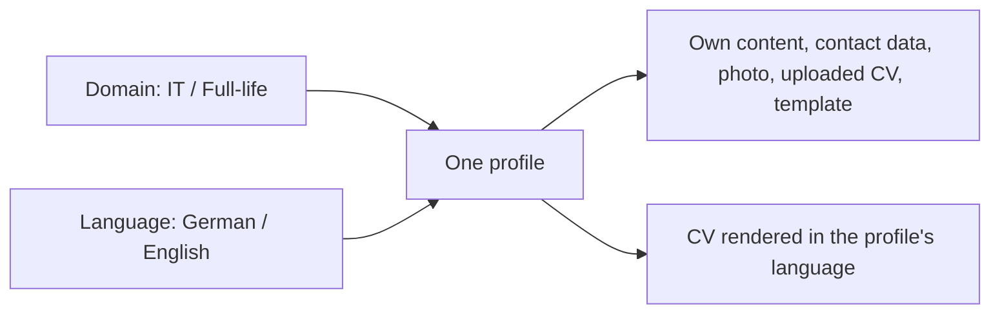
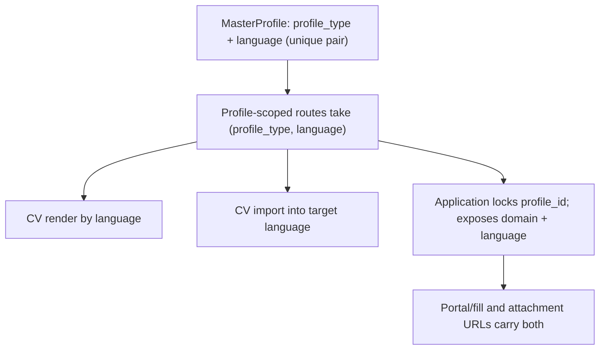

# Bilingual CV Profiles - Plan

## Goal Capsule

- **Objective:** Make German and English first-class CV languages by modeling language as a dimension of the profile — four independent profiles (IT / Full-life × German / English) selected with a domain toggle plus a language toggle — so the Profile page, CV Builder, preview/export, CV import, and application flow all operate on the chosen language profile.
- **Product authority:** This plan, from brainstorm dialogue confirmed 2026-11-16. It reverses the English-only CV direction of `docs/plans/2026-09-13-005-refactor-remove-translation-functionality-plan.md` for the CV/CV-document scope, without restoring that plan's removed UI-switcher or per-field translation machinery.
- **Open blockers:** None.

---

## Product Contract

### Summary

Language becomes a property of the profile. The app supports four addressable domain/language combinations — IT-English, IT-German, Full-life-English, Full-life-German — chosen with a domain toggle and a language toggle wherever a profile is addressed; English variants are created on demand from their German sibling. The CV Builder renders each profile's CV fully in that profile's language, and the application flow uses the same profile for cover-letter tailoring and its uploaded CV attachment.

### Problem Frame

The app can generate a German cover letter but only an English CV. The CV renderer's chrome is fixed English, the preview sample is English-only, and the PDF import forces English output, so a German-speaking applicant cannot produce a German CV from maintained content. The earlier global language machinery — a header switcher, per-field content translation, and per-language DB columns — was deliberately removed as unnecessary; what is missing is not translation infrastructure but a way to keep genuinely separate German and English CVs and render each in its own language.

### Key Decisions

- **Language is a dimension of the profile, not a separate document setting** (session-settled: user-directed — chosen over one profile holding both language versions: fully separate CVs, no merged content). Governs R1, R2, R5.
- **Existing IT/Full-life profiles become the German variants** (session-settled: user-directed — chosen over treating them as English: matches the content actually stored). Governs R3.
- **Content is maintained separately per language; AI translation happens only on import** (session-settled: user-directed — chosen over per-field or automatic translation: full manual control of each version). Governs R4, R9.
- **Cover letters stay German for every profile language** (session-settled: user-directed — chosen over following the profile language: keeps the existing German letter unchanged). Governs R11.
- **Application email keeps attaching the profile's uploaded CV file, not the builder-rendered PDF** (session-settled: user-directed — chosen over rendering at send time: smaller scope, existing behavior). Governs R13.
- **New language variants start from the sibling's contact data and photo** (session-settled: user-directed — chosen over retyping everything: less duplication). Governs R3.
- **Two selectors (domain + language), and the "other profile" action offers the three remaining combinations** (session-settled: user-directed — chosen over a single four-way control: simpler per-dimension switching). Governs R2, R12.

### Requirements

**Profile model and selection**

- R1. A profile is addressed by domain (IT / Full-life) and language (German / English); each of the four combinations is an independent profile with its own content, contact data, photo, uploaded CV file, attachments, template, and sender address.
- R2. The Profile page and CV Builder each expose a domain selector and a language selector, and the application editor's profile picker offers the same two choices; changing either loads that combination's profile.
- R3. Existing IT/Full-life profiles become the German variants. An English variant is created on demand with the German sibling's contact data and photo copied in, then edited independently; when no German sibling exists, it starts empty.

**CV Builder content and rendering**

- R4. The CV Builder edits only the selected profile; summary, job title, experience, education, skills, spoken languages, and projects are per profile.
- R5. Preview and export render the document fully in the selected profile's language: `lang` attribute, title, page footer, section headings, skill-level labels, photo alt and placeholder, and open-ended date wording. No separate document-language setting exists.
- R6. German chrome uses "Lebenslauf" as the title, "Seite X von Y" as the footer, "seit {start}" for open-ended dates, and section headings "Kontakt", "Profil", "Berufserfahrung", "Ausbildung", "Sprachen", "Projekte"; "Skills" stays "Skills".
- R7. Preview uses language-matched sample content — a German sample for German profiles, the English sample for English profiles.
- R8. Exported PDF filenames are language-matched (`resume_<name>.pdf` for English, `lebenslauf_<name>.pdf` for German).

**CV import**

- R9. Importing a CV PDF fills the currently selected profile, with the AI producing the extracted content in that profile's language and translating the source when it differs.
- R10. Import leaves every other profile unchanged.

**Application flow**

- R11. An application is generated against one profile (domain + language) chosen on first generation and locked to it afterward; the cover letter stays German regardless of the profile's language.
- R12. The profile picker offers domain + language, and "start a new application with the other profile" allows choosing any of the three other combinations.
- R13. Sending an application attaches that profile's uploaded CV file; the builder-rendered PDF is not attached automatically.

### Key Flows

- F1. Create and edit a language variant
  - **Trigger:** The user selects a language whose variant does not yet exist.
  - **Steps:** The app creates the variant with contact data and photo copied from the sibling, opens it with empty CV content, and saves edits independently.
  - **Covered by:** R3, R4.
- F2. Export a CV in a chosen language
  - **Trigger:** The user selects domain + language and opens Preview & Export.
  - **Steps:** The builder loads that profile's content and template; the preview renders localized chrome (and the language-matched sample when empty); export produces a PDF with a language-matched filename.
  - **Covered by:** R5, R6, R7, R8.
- F3. Import a CV into the selected profile
  - **Trigger:** The user uploads a CV PDF while a profile is selected.
  - **Steps:** The AI parses the file and returns content in the profile's language, replacing that profile's content only.
  - **Covered by:** R9, R10.
- F4. Apply with a profile
  - **Trigger:** The user generates an application.
  - **Steps:** The user picks domain + language; the German cover letter is tailored from that profile's content and the profile is locked; sending attaches that profile's uploaded CV file.
  - **Covered by:** R11, R12, R13.

### Acceptance Examples

- AE1. **Covers R1, R2.** Given the CV Builder, when the user switches domain to Full-life and language to German, then the Full-life German profile loads and edits save only there.
- AE2. **Covers R3.** Given existing German profiles after migration, when the user first selects an English variant, then it exists with the German sibling's contact data and photo copied in and empty CV content ready to edit.
- AE3. **Covers R5, R6.** Given a German profile, when the user previews or exports, then the document renders `lang="de"`, "Lebenslauf", "Seite … von …", German section headings, and "seit {start}", with no language control in the flow.
- AE4. **Covers R9, R10.** Given the English profile is selected, when the user imports a German CV PDF, then the English profile receives English content and the German profile is unchanged.
- AE5. **Covers R11, R13.** Given an application generated against an English profile, when the user sends it, then the cover letter is German and the attachment is that profile's uploaded CV file.
- AE6. **Covers R12.** Given an application locked to IT-German, when the user chooses "start a new application with the other profile", then they can select any of IT-English, Full-life-German, or Full-life-English.

### Scope Boundaries

- **Not part of this change:** a German app UI (nav, labels, and messages stay English — only the generated CV is bilingual); English cover letters; AI translation during editing or export; restoring the old header language switcher, per-field translate buttons, or translation DB columns; and rendering the builder PDF at send time.
- **Deferred for later:** languages beyond German and English; automatic backfill of existing content into the other language.

### Dependencies / Assumptions

- Existing CV content is German, so migration assigns the current IT/Full-life rows to German; English variants start empty.
- The uploaded CV file is per profile, so an English variant has no CV file until one is uploaded there — copy-on-create covers contact data and photo only.
- The cover-letter generator keeps its German-only prompt.
- German chrome wording reuses the vocabulary established in `docs/plans/2026-09-13-002-feat-cv-document-language-plan.md`; no new copy is invented.
- Language is a new addressing dimension for every profile lookup, not just the CV Builder.

### Outstanding Questions

- **Deferred to Planning:** the exact persistence shape for the language dimension (for example a language field with composite uniqueness versus an extended profile type), the migration default and lazy versus eager creation of English variants, whether copy-on-create also copies the template choice, the toggle labels, and how portal-fill and attachment downloads take the language.

### Sources / Research

- English-only removal and its settled rationale: `docs/plans/2026-09-13-005-refactor-remove-translation-functionality-plan.md`.
- Prior German chrome vocabulary and localization work: `docs/plans/2026-09-13-002-feat-cv-document-language-plan.md`, `docs/plans/2026-09-13-003-feat-global-language-unification-plan.md`.
- Current CV rendering and chrome: `backend/app/services/pdf_service.py`, `backend/app/templates/cv/`.
- Current sample content and import: `backend/app/services/cv_sample_content.py`, `backend/app/services/pdf_parser.py`, `backend/app/api/cv_builder.py`.
- Current profile model and addressing: `backend/app/models/master_profile.py`, `backend/app/api/profile.py`, `backend/app/api/applications.py`, `backend/app/services/ai_generator.py`.
- Current frontend surfaces: `frontend/src/app/pages/profile/`, `frontend/src/app/pages/cv-builder/`, `frontend/src/app/pages/application-editor/`.
- Constraining tests: `backend/tests/services/test_pdf_service.py`, `backend/tests/services/test_pdf_parser.py`, `backend/tests/api/test_cv_builder.py`, `frontend/src/app/pages/cv-builder/**/*.spec.ts`.

---

## Planning Contract

**Product Contract preservation:** R1–R13, Key Decisions, Key Flows, Acceptance Examples, and Scope Boundaries are preserved. The Summary and Goal Capsule wording was clarified to state that English variants are created on demand — no scope change.

### Key Technical Decisions

- KTD1. **Persist `language` as its own column with a composite unique `(profile_type, language)`**, rather than folding language into `profile_type` strings. Keeps `profile_type` meaning domain everywhere and makes the two addressed dimensions explicit. Existing rows backfill to `de`. New Alembic revision parents on the current sole head `e4c9a1b2d3f6`; drop the single-column unique and add the composite one via `batch_alter_table`. Governs R1, R3.
- KTD2. **`language` is a required query parameter on every client-facing profile-scoped route** (`/profile/...`, `/cv-builder/...`, application generate). No silent client default — omitting it is a validation error, so a wrong-language read cannot happen by accident. Application regeneration is addressed by `application_id` (KTD6), so `language` is required only when no application id is given. The legacy untyped-row `migration-status`/`migrate` routes stay language-free; the migrated row keeps its `de` default. Governs R2.
- KTD3. **A dedicated ensure-create endpoint clones the sibling language profile on demand.** On first selection of a missing variant it copies `full_name`, `email`, `phone`, `address`, `linkedin`, `website`, `sender_email`, and physically copies the photo bytes/filename to the new profile's id-scoped path. It does not copy CV content, the uploaded CV file, attachments, or `template_id`; the copy is a one-time snapshot. With no sibling it returns 404 and the UI shows an empty form that the first PUT persists. The endpoint is idempotent — a concurrent insert that hits the composite unique is rolled back and re-queried — and, being a body-less POST, it is a CORS simple request; the single-user app accepts that surface. Governs R3.
- KTD4. **Keep the current flat `_DOC_CHROME` contract and key it by language**, preserving the current English `profile: "Summary"` value and the existing `lang` key (its value switches between `de` and `en`). German vocabulary comes from `docs/plans/2026-09-13-002-feat-cv-document-language-plan.md`; `SAMPLE_DE` and `seit {start}` are added. `render_cv_pdf` gains a required `language` argument; existing service tests are updated to pass `en`. The API always passes the profile's language. CV templates stay structurally untouched and keep `display: table`/`table-cell`. Governs R5, R6, R7, R8.
- KTD5. **CV import becomes language-targeted and stays on the shared LLM path.** `POST /cv-builder/parse` gains a required `language`; the prompt instructs output in that language and translation when the source differs; all calls keep routing through `generate_structured()`/`llm_client` (no second Ollama client). The CV Builder clears its stale pending parsed result on failure (U6). Governs R9, R10.
- KTD6. **Applications carry `language` alongside the domain, keep the existing `profile_id` lock, and fix regenerate scoping.** `ApplicationRead` exposes both derived values. `ApplicationGenerateRequest` gains an optional `application_id`; when present, the backend targets exactly that row, and `(profile_type, language)` is required only for first generation. At most one application exists per `(job_offer, domain, language)`; the generate path (including `for_new_application`) opens the existing combination instead of creating a duplicate. Portal-fill identity lookups and submission attribution resolve by application id, not by job URL/offer alone. Generating against a profile with no CV content is blocked with a clear error that links to that profile. The German cover-letter prompt uses the locked profile's facts and is told to write German (translating facts); it never reads the sibling profile. Governs R11, R12, R13.
- KTD7. **Two selectors route through one guarded switch.** The Profile page and CV Builder add a language selector beside the existing domain control; both call a single switch that confirms unsaved changes once and restores both controls on cancel. The application picker offers domain + language; the "other profile" action opens that picker for the three remaining combinations. The same switch — including the application picker — calls ensure-create for a missing variant, holds the controls pending until it resolves, and reverts both controls with an inline error on failure. Default language is `de`; missing-profile errors name the full combination. Governs R2, R12.
- KTD8. **Rewrite the English-only assertions into per-language assertions instead of deleting them.** `TestFixedEnglishChrome`, the parser's English-only prompt assertion, the render-payload no-language assertions, and the frontend "no language control" specs become language-parameterized coverage; keep and extend `TestMultiPageFragmentation` with overflowing German content. Governs R5, R9.

### High-Level Technical Design

The language dimension lives on the profile row, so every surface reads it from the same address rather than from a separate setting. Rendering and import consume the language directly; applications lock one profile row and derive both dimensions from it.

### System-Wide Impact

- **Backend:** `MasterProfile` model and schemas, a new Alembic revision, all profile-scoped routes (`profile.py`; roughly 14 lookup sites), `cv_builder.py` (render, preview, export, parse), `applications.py` (generate, regenerate, send), `portal_fill.py` (document URLs and submission attribution), `portal_fill_requests.py` (resolve by application id), and `pdf_service.py`/`pdf_parser.py`/`cv_sample_content.py`.
- **Frontend:** profile/application models and services, the Profile page, CV Builder (sections, export, import), the applications overview (link the exact application), and the application editor (profile picker, "other profile" action).
- **Data:** existing IT/Full-life rows become German; English variants begin empty and have no uploaded CV file until one is uploaded there.
- **Unaffected:** the browser extension has no direct profile-scoped API calls beyond portal-fill document URLs; the German cover-letter prompt keeps its language and gains a fact-translation instruction, and the uploaded-CV attachment source stays in place.

### Risks & Dependencies

- **Data migration and constraint swap (high).** Adding the column and replacing the unique constraint on SQLite requires `batch_alter_table`; a bad revision can silently skip sibling branches. Mitigate with a forward-only revision parented on the sole head, idempotent inspect guards, and upgrade/downgrade tests.
- **Broad profile-addressing surface.** Missing one `profile_type`-only lookup yields a silent wrong-language read or a 404. Enumerate every `filter_by(profile_type=...)`, every route signature, and every frontend service call.
- **Rendering regression.** German labels are longer; the WeasyPrint two-column layout must keep fragmenting across pages. Keep `display: table`/`table-cell` and assert on extracted page-1 text.
- **Shared Ollama plumbing.** Import translation must not create a second client; keep `_ollama_lock`/`keep_alive=0` and the structural-failure fallback.
- **Test suite encodes English-only.** The backend and frontend constraint suites must change in the same units as the behavior; otherwise the suite contradicts the feature.
- **Regenerate ambiguity.** Multiple applications per job already exist via `for_new_application`; resolving regeneration or portal submission by `.first()` by job can overwrite or misattribute the wrong locked profile. Scope both by application id.
- **Downgrade data loss.** Restoring the single-column unique cannot succeed once a domain has both `de` and `en` rows; the downgrade must delete `en` rows or refuse with a clear guard. Document the choice; do not claim a lossless symmetric downgrade.
- **Ensure-create race.** A read-then-create without IntegrityError handling fails on concurrent first selections; roll back and re-query to stay idempotent.
- **Empty English variants.** Sending an English-profile application requires an uploaded CV there; copy-on-create deliberately does not copy the file. This is the accepted call-out from the brainstorm, and the export→import flow is the bootstrap for the content itself.

### Assumptions

- `profile_type` continues to mean the domain; `language` is the new `de`/`en` dimension.
- Existing typed rows and the legacy untyped row receive `language = "de"`.
- Copy-on-create covers identity fields, `sender_email`, and the photo; it excludes template, CV content, uploaded CV file, and attachments.
- At most one application exists per `(job_offer, domain, language)`; the generate path enforces it and opens the existing row. Regeneration is addressed by `application_id`; first generation requires `(profile_type, language)`. Existing duplicate rows are audited, not auto-merged.
- Portal-fill identity requests and submission attribution resolve by application id, not by job URL/offer alone.
- Generating against a profile with no CV content is blocked with a clear error; the supported bootstrap for an empty English variant is the export→import flow, where the language-aware import translates the German content.
- Ensure-create is a body-less POST (a CORS simple request); that surface is accepted for this single-user app.
- The German cover letter is produced from the locked profile's facts with explicit translation instruction.
- The app UI stays English; only the generated CV document is bilingual.

### Deferred to Implementation

- Exact toggle styling and label wording.
- Whether filename collisions across the two domains need a domain component beyond R8's `resume_`/`lebenslauf_` prefix (R8 is preserved as written).
- The exact German sample copy (reuse the removed implementation — commit `14ddacf` — and the 2026-09-13-002 plan vocabulary).
- Final error-string wording for missing combinations.

### Sequencing

U1 → U2 → {U3, U4, U5} → U6 → U7. U3 and U4 can proceed in parallel after U2; U5 depends only on U2; U6 delivers the German CV end-to-end (Profile + CV Builder); U7 adds the application surfaces after U5 and U6.

---

## Implementation Units

### U1. Add the language dimension to the profile model and migration

- **Goal:** Persist a profile's language and allow four profiles per domain while keeping `profile_type` as the domain.
- **Requirements:** R1, R3.
- **Dependencies:** None.
- **Files:** `backend/app/models/master_profile.py`, `backend/app/schemas/master_profile.py`, `backend/alembic/versions/<new-revision>_add_profile_language.py`, `backend/tests/services/test_master_profile_schema.py`, `backend/tests/test_migrations.py`.
- **Approach:**
  1. Add a non-null `language` enum/string (`de`/`en`) to `MasterProfile`; the migration uses a temporary `de` server default for the backfill and then clears it, so every insert must pass a language. Define `ProfileLanguage = Literal["de", "en"]` in the schemas.
  2. Replace `uq_master_profiles_profile_type` with a composite unique on `(profile_type, language)`.
  3. Expose `language` on the read schema; the language is supplied by the route's `language` query parameter and never by the create/update body, so a body cannot silently reassign a profile's language.
  4. Add the forward migration parented on `e4c9a1b2d3f6`: add the column with a temporary `de` server default, backfill existing rows, clear the default, drop the old unique, and add the composite unique via `batch_alter_table`. The downgrade is data-aware: restoring the single-column unique cannot succeed when a domain has both `de` and `en` rows, so it either deletes `en` rows or refuses with a clear guard — pick one, document it, and test it. Update the pinned head in `test_migrations.py`.
  5. Update the stale "genau ein MasterProfile-Datensatz" docstring.
- **Patterns to follow:** `backend/alembic/versions/9a7b6c5d4e3f_add_content_language.py` (column with server default, then clear it), `backend/alembic/versions/f71a8d3d7876_add_profile_type_and_application_.py` (batch constraint change).
- **Test scenarios:**
  - Happy path: upgrading a DB holding `it` and `full_life` rows backfills both to `language = "de"`.
  - Happy path: `(it, de)` and `(it, en)` coexist; each is independently readable.
  - Error path: a second `(it, de)` insert raises an integrity error.
  - Regression: downgrade restores the single-column unique and removes the column on a German-only DB; after an English variant exists it follows the documented data-aware policy (delete or refuse); the ORM/migration parity test and the updated head assertion pass.
- **Verification:** `pytest backend/tests/test_migrations.py backend/tests/services/test_master_profile_schema.py` passes and `alembic heads` shows one head.

### U2. Thread language through profile addressing and copy-on-create

- **Goal:** Every profile-scoped endpoint addresses `(profile_type, language)`, and a missing language variant can be created by cloning its sibling.
- **Requirements:** R1, R2, R3.
- **Dependencies:** U1.
- **Files:** `backend/app/api/profile.py`, `backend/app/schemas/master_profile.py`, `backend/tests/api/test_profile.py`.
- **Approach:**
  1. Extend the profile lookup helper and every direct query to filter on both dimensions; update all call sites.
  2. Add a required `language` query parameter to GET/PUT/PATCH and the cv-file/photo/attachment subroutes.
  3. Key the PUT upsert on `(profile_type, language)`.
  4. Add `POST /profile/{profile_type}/ensure` (required `language`): return the existing profile, or clone identity fields and physically copy the photo; return 404 when no sibling exists. The extra path segment avoids shadowing the static `POST /profile/migrate` route. Handle a concurrent insert with an IntegrityError rollback + re-query so the endpoint is idempotent.
  5. Keep the untyped-row migration routes language-free; the migrated row keeps `de`.
- **Patterns to follow:** the existing `_IDENTITY_FIELDS` handling and the photo path/upload helpers in `backend/app/api/profile.py`.
- **Test scenarios:**
  - Happy path: each route returns the row for the exact `(profile_type, language)` pair.
  - Edge case: a missing combination 404s; PUT creates independent rows per language so editing English leaves German untouched.
  - Integration: ensure-create copies identity and photo bytes and does not copy content, uploaded CV, attachments, or template; later sibling edits do not propagate; a concurrent duplicate insert returns the winner rather than a 500.
  - Error path: ensure-create with no sibling returns 404, and the legacy migrate assigns the untyped row to the chosen domain with `de`.
- **Verification:** `pytest backend/tests/api/test_profile.py` passes.

### U3. Language-aware CV rendering, preview, and export

- **Goal:** Preview and export render the selected profile's CV fully in its language with a language-matched sample and filename.
- **Requirements:** R5, R6, R7, R8.
- **Dependencies:** U1, U2.
- **Files:** `backend/app/api/cv_builder.py`, `backend/app/services/pdf_service.py`, `backend/app/services/cv_sample_content.py`, `backend/tests/services/test_pdf_service.py`, `backend/tests/api/test_cv_builder.py`. Templates under `backend/app/templates/cv/` are expected to stay untouched.
- **Approach:**
  1. Key `_DOC_CHROME` by language, preserving the current English values (including `lang`) and adding the German vocabulary.
  2. Add `SAMPLE_DE` alongside `SAMPLE_EN`.
  3. Add a required `language` argument to `render_cv_pdf`; select chrome, skill labels, date wording, sample, and `lang`. Update the existing service-test call sites to pass `en`.
  4. Require `language` on preview/export, pass the profile's language, and produce language-matched preview/export filenames.
  5. Keep template layout unchanged; keep `display: table`/`table-cell`.
- **Patterns to follow:** `docs/plans/2026-09-13-002-feat-cv-document-language-plan.md` for the German strings; `docs/solutions/ui-bugs/weasyprint-flexbox-does-not-fragment-across-pages.md`.
- **Test scenarios:**
  - Happy path: each template renders German chrome (`lang="de"`, "Lebenslauf", "Seite … von …", German headings) and English chrome for English.
  - Happy path: preview uses the language-matched sample; open-ended dates render `seit {start}` in German and `present` in English.
  - Edge case: empty/partial content still renders a header-only CV without error.
  - Regression: multi-page German content keeps the name on page 1 and paginates; language-matched filenames appear in `Content-Disposition`.
- **Verification:** `pytest backend/tests/services/test_pdf_service.py backend/tests/api/test_cv_builder.py` passes.

### U4. Language-aware CV import

- **Goal:** Import fills the selected profile with content in that profile's language, translating the source when it differs.
- **Requirements:** R9, R10.
- **Dependencies:** U1, U2.
- **Files:** `backend/app/services/pdf_parser.py`, `backend/app/api/cv_builder.py`, `backend/tests/services/test_pdf_parser.py`, `backend/tests/api/test_cv_builder.py`.
- **Approach:**
  1. Make the extraction prompt language-aware: output in the target language, translate when the source differs, keep proper nouns.
  2. Extend the parser helpers to accept the target language and keep routing through `generate_structured()`/`llm_client`.
  3. Require `language` on the parse endpoint.
  4. Add a structural-fallback regression test for the import schema.
- **Patterns to follow:** `docs/solutions/integration-issues/ollama-structured-output-nested-list-schema-validation-failure.md`, `docs/solutions/performance-issues/ollama-concurrent-model-residency-memory-pressure.md`.
- **Test scenarios:**
  - Happy path: a German source parsed for an English profile yields English values; an English source parsed for a German profile yields German values.
  - Edge case: proper nouns and URLs stay unchanged across translation.
  - Error path: a parse failure surfaces and leaves the profile unchanged; the structural-fallback path still returns a valid result.
- **Verification:** `pytest backend/tests/services/test_pdf_parser.py backend/tests/api/test_cv_builder.py` passes.

### U5. Application flow: domain + language selection, lock, and cover letter

- **Goal:** Applications pick and lock a `(domain, language)` profile; the picker offers four combinations; sending uses that profile; the cover letter stays German.
- **Requirements:** R11, R12, R13.
- **Dependencies:** U2.
- **Files:** `backend/app/schemas/application.py`, `backend/app/models/application.py`, `backend/app/api/applications.py`, `backend/app/api/portal_fill.py`, `backend/app/services/portal_fill_requests.py`, `backend/app/services/ai_generator.py`, `backend/tests/api/test_applications.py`, `backend/tests/api/test_portal_fill.py`.
- **Approach:**
  1. Add `language` and an optional `application_id` to the generate request; resolve by application id when present, otherwise by `(profile_type, language)`; expose the derived language on the application read shape.
  2. Keep the `profile_id` lock; regeneration targets the application id instead of `.first()` by job.
  3. Open the existing application when the chosen combination already has one, including on the `for_new_application` path, so a combination never duplicates.
  4. Resolve portal-fill identity requests and `record_portal_submission` by application id; build CV/attachment download URLs with both dimensions.
  5. Keep the German prompt and instruct it to write German from the locked profile's facts; never read the sibling.
  6. Block generation with a clear error when the selected profile has no CV content.
  7. Keep the uploaded CV file as the send attachment.
- **Patterns to follow:** the existing `profile_id` lock and `for_new_application` escape hatch in `backend/app/api/applications.py`.
- **Test scenarios:**
  - Happy path: generating with each combination locks the matching profile and exposes the domain + language.
  - Edge case: regenerate after opening one of several applications targets that application id, not another row for the same job.
  - Error path: selecting an existing combination opens it rather than creating a duplicate; generating against an empty profile is refused with a clear message.
  - Integration: an English-profile application produces a German cover letter and attaches that profile's uploaded CV file; portal URLs carry the language, and a portal submission for one of two same-job applications records against the correct application id.
- **Verification:** `pytest backend/tests/api/test_applications.py backend/tests/api/test_portal_fill.py` passes.

### U6. Frontend: Profile and CV Builder language selectors and CV flows

- **Goal:** Make the German CV usable end-to-end and wire the language selector through the Profile page, CV Builder, preview/export, and import.
- **Requirements:** R2, R3, R4, R7, R8, R9.
- **Dependencies:** U2, U3, U4.
- **Files:** `frontend/src/app/core/models/master-profile.model.ts`, `frontend/src/app/core/services/profile.service.ts`, `frontend/src/app/pages/profile/**`, `frontend/src/app/pages/cv-builder/**`, and their specs.
- **Approach:**
  1. Add `ProfileLanguage = 'de' | 'en'` and a `language` field to the profile read model; thread `language` through `ProfileService` methods.
  2. Profile page: add a language selector beside the domain tabs and route both through one guarded switch that calls ensure-create for a missing variant. Hold the controls pending until the clone resolves, load the form only after it completes, and revert both controls with an inline error on failure. Show a one-time notice when a variant is created.
  3. CV Builder: use the same two selectors and the same ensure-create switch; pass `language` to preview, export, and parse; use a language-matched preview filename; clear the pending parsed result on a parse failure.
  4. Point an empty variant at the supported bootstrap: export the German CV and import it into the empty profile, where the language-aware import translates it. Keep the CV Builder empty-state copy language-aware.
  5. Keep every UI label English; label both toggles and announce the newly loaded combination in an aria-live region.
- **Patterns to follow:** the existing profile-type switches and `window.confirm` unsaved guards in `profile.component.ts` and `cv-builder.component.ts`.
- **Test scenarios:**
  - Happy path: switching to a missing language creates/prefills the variant; unsaved-change confirmation restores both controls on cancel; a failed ensure-create reverts both controls and shows an inline error.
  - Happy path: CV Builder sends the selected language for preview/export/parse.
  - Edge case: a failed parse clears the pending parsed result so an earlier import cannot be applied.
  - Integration: the empty-state notice names the missing combination and points to the export→import bootstrap.
  - Regression: all UI labels remain English; keyboard switching and the aria-live announcement work.
- **Verification:** `cd frontend && npm run test:vitest` (or `ng test`) passes.

### U7. Frontend: application picker, editor, and applications overview

- **Goal:** Let an application choose and display the locked `(domain, language)` profile across the picker, editor, and overview.
- **Requirements:** R11, R12.
- **Dependencies:** U5, U6.
- **Files:** `frontend/src/app/core/models/application.model.ts`, `frontend/src/app/core/services/application.service.ts`, `frontend/src/app/pages/application-editor/**`, `frontend/src/app/pages/applications/**`, and their specs.
- **Approach:**
  1. Add `language` and the optional `application_id` to the application read/request models; thread them through `ApplicationService`.
  2. The profile picker offers domain + language and calls ensure-create for a missing variant (reusing U6's switch behavior) before generating; show the locked combination in the editor.
  3. Regenerate sends the opened `application.id`; the "other profile" action opens the picker for the three remaining combinations and opens an existing combination instead of duplicating.
  4. The applications overview links each card to `/editor/{jobOfferId}/{applicationId}` so the clicked combination opens; keep the editor's existing send behavior unchanged.
  5. Keep every UI label English and update the specs that assert one "other profile".
- **Patterns to follow:** the existing application profile dialog and the editor's optional `:applicationId` route.
- **Test scenarios:**
  - Happy path: the picker offers all four combinations and generating locks the chosen one; the editor shows the locked domain + language.
  - Edge case: regenerate sends the opened application id and does not touch another row for the same job.
  - Edge case: choosing an existing combination opens it instead of duplicating.
  - Integration: the overview link opens the exact application when a job has several.
  - Regression: all UI labels remain English.
- **Verification:** `cd frontend && npm run test:vitest` (or `ng test`) passes.

---

## Verification Contract

| Unit | Command | Done signal |
|---|---|---|
| U1 | `cd backend && pytest tests/test_migrations.py tests/services/test_master_profile_schema.py` | Upgrade/downgrade and composite uniqueness pass; migration parity holds; one head. |
| U2 | `cd backend && pytest tests/api/test_profile.py` | Every route resolves `(profile_type, language)`; copy-on-create and legacy migrate pass. |
| U3 | `cd backend && pytest tests/services/test_pdf_service.py tests/api/test_cv_builder.py` | German/English chrome, sample, dates, filenames, and multi-page fragmentation pass. |
| U4 | `cd backend && pytest tests/services/test_pdf_parser.py tests/api/test_cv_builder.py` | Target-language import and structural fallback pass. |
| U5 | `cd backend && pytest tests/api/test_applications.py tests/api/test_portal_fill.py` | Combination selection/lock, regenerate scoping, German letter, uploaded attachment, portal URLs pass. |
| U6 | `cd frontend && npm run test:vitest` | Profile/CV Builder selectors, guard, ensure-create, import reset, and English UI pass. |
| U7 | `cd frontend && npm run test:vitest` | Four-way application picker, application-id regenerate, overview deep link, and English UI pass. |
| All | `cd backend && pytest`; `cd frontend && npm run test:vitest` | Full suites green. |

## Definition of Done

- [ ] Four profiles are addressable by `(domain, language)`; existing rows are German; English variants are created by copying identity + photo.
- [ ] German and English CV chrome, samples, dates, and filenames render from the profile's language with no separate document-language control.
- [ ] CV import fills the selected profile in its language and leaves other profiles untouched.
- [ ] Applications select and lock a `(domain, language)` profile, one per combination, regenerate by application id, resolve portal fills/submissions by application, and send that profile's uploaded CV file; the cover letter stays German.
- [ ] The migration applies cleanly, its data-aware downgrade behaves as documented, and the ORM/migration parity test passes.
- [ ] The English-only tests are rewritten to per-language coverage and both full suites are green.
